# AILA — Architecture Reference

AILA (product name for the codebase historically called *LexChat*) is a family of AI
legal-research assistants for a UK government organisation. This document is the architectural
reference: it presents the system through a series of complementary **views**, each with a Mermaid
diagram.

For narrative product detail see [SPECIFICATION.md](SPECIFICATION.md); for low-level schema/flow
detail see [DESIGN.md](DESIGN.md); for the authoritative endpoint list see
[api/ServerAPISpec.md](api/ServerAPISpec.md); for firewall/allowlist detail see
[NETWORK_AND_DEPENDENCIES.md](NETWORK_AND_DEPENDENCIES.md); for what legislation and case-law data is
held and where each gap lies see [LEGAL_DATA_SOURCES.md](LEGAL_DATA_SOURCES.md). Row IDs such as
P3.31 refer to the pre-pilot fix plan, [prepilot-fixes/FIX_PLAN.md](prepilot-fixes/FIX_PLAN.md),
which carries each change's evidence.

> **Guiding principle: one codebase, many bots.** There is a single backend (`server_py/`) and a
> single frontend (`client/`). Every bot — the legislation assistant, the Scottish Parliament
> (Holyrood) bot, the Westminster bot, and any future bot — runs the *same* `uvicorn src.main:app`,
> differentiated by **configuration, not forked code**.

**The fleet as built:** legislation (AILA, `legislation_only`), Holyrood parliament (ParliChat,
`parliamentary_records`) and Westminster (HansardChat, `westminster_records`) are live. A
legislative-drafting bot (`drafting`) is in build on the long-lived `feature/drafting-bot` branch and
is deliberately *not* on `main` — see [drafting/BUILD_PLAN.md](drafting/BUILD_PLAN.md).

---

## 1. System context

Who and what the system talks to. The organisation runs one or more **bot processes**; each serves
qualified-lawyer users and reaches out to LLM providers and research APIs. Bots can consult each
other via federation.

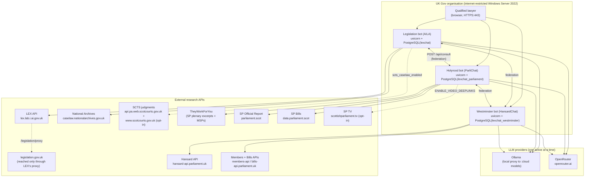

**Notes**
- The target is *internet-restricted* (whitelist-only outbound), not air-gapped. Each external host
  above must be whitelisted for the corresponding bot — see [NETWORK_AND_DEPENDENCIES.md](NETWORK_AND_DEPENDENCIES.md).
- **legislation.gov.uk is never called directly.** Everything the legislation bot reads from it —
  commencement dates for the change record, the made-under record's daily refresh, and the text of
  an instrument the LEX index lacks — goes through LEX's `GET /legislation/proxy/{path}`, so it
  needs no whitelist entry of its own (§10).
- **Scottish judgments (SCTS)** are behind the Developer-tab feature flag `scts_caselaw_enabled`,
  default off. Switch it on only once both SCTS hosts are reachable from the server
  (`server_py/test_apis.ps1`, tests 8a and 8b); reading a judgment's text also needs pdfplumber.
- The Holyrood bot is **Scotland-only**; Westminster/Hansard coverage moved to its own bot rather
  than back into the Holyrood toolset.
- `ENABLE_WESTMINSTER_VIDEO_DEEPLINKS` / `PLIVE_BASE_URL` exist as settings, but parliamentlive.tv
  deep links are **not implemented** — see [parliament/WESTMINSTER_VIDEO_IMPLEMENTATION_PLAN.md](parliament/WESTMINSTER_VIDEO_IMPLEMENTATION_PLAN.md).

---

## 2. Container / component view (a single bot process)

One uvicorn process serves both the pre-built React UI (static files) and the `/api` backend. The
agent pipeline is provider-agnostic: a `ContextVar` carries the resolved provider config through the
whole async call chain.

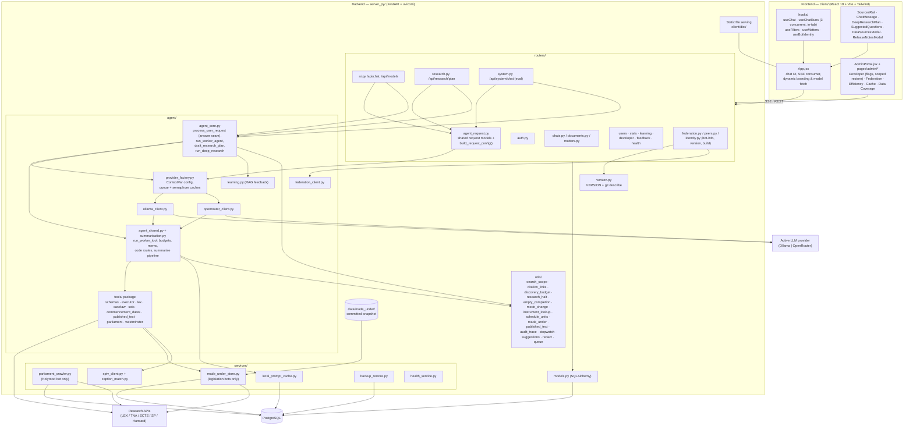

**Key design points**
- **Provider abstraction** — `ollama_client.py` and `openrouter_client.py` each implement the same
  ReAct `chat_loop`; `agent_shared.py` + `summarisation.py` hold the shared tool-execution and
  summarisation pipeline. The active provider is resolved per request from the `app_settings` table
  and carried by a `ContextVar` — no function signatures change when the provider switches.
- **One request-config seam** — `routers/agent_request.py` defines `AgentRequestBase` → `ChatRequest`
  → `SystemChatRequest` (a *subclass*, so a field added to `/api/chat` is accepted by the eval
  endpoint automatically) plus the single `build_request_config()` all three entry routers use.
  Duplicating that config block is what previously caused `/api/system/chat` to silently drop
  `chat_mode`, filters and Deep Research.
- **Runtime feature flags** — the flags live in one `app_settings` row (`features`) and
  `build_request_config()` copies each onto the request config (`_suggested_questions_enabled`,
  `_scts_caselaw_enabled`, …), so a change takes effect on the next request with no restart.
  User-facing flags sit on Developer → Configuration → Feature Flags (`matters_enabled`,
  `research_mode_enabled`, `deep_research_mode_enabled`, `suggested_questions_enabled`,
  `session_feedback_enabled`, `weekly_survey_enabled`, `scts_caselaw_enabled`); the three caching
  flags sit on the Cache tab (§8). The two feedback instruments and `scts_caselaw_enabled` default
  off; until it is first saved, `scts_caselaw_enabled` takes its default from the
  `SCTS_CASELAW_ENABLED` setting.
- **Code enforcement over prompt obedience** — where a rule must hold on every turn (budgets,
  scope disclosures, citation links, halt and lost-step disclosures, the sources rail), it is
  enforced in code at a seam (§4, §5) and the prompt carries it only as guidance; FIX_PLAN's
  invariants record the measurements behind this. Every such code route is fail-soft: on any
  failure the result is what it would have been without it.
- **Per-provider concurrency** — a `RequestQueue` (`max_concurrent_requests`) and a summarisation
  `asyncio.Semaphore` (`max_summarise_concurrency`) are cached per `(provider, concurrency)` and
  recreated automatically when settings change.
- **No global auth middleware** — every protected route declares `Depends(get_current_user)`
  explicitly. Public routes: `/api/auth/login`, `/api/health`, and the identity endpoints.
- **Log redaction** — user content and PII are redacted at INFO (`utils/redact.py` renders
  `<N chars, sha1:…, 'prefix…'>`) and appear in full only at DEBUG. `redact_args` is
  allowlist-based, so a new free-text tool parameter loses log fidelity rather than confidentiality.

---

## 3. One codebase, many bots

Behaviour is switched at runtime by configuration under `bots/<id>/`, not by branching code.

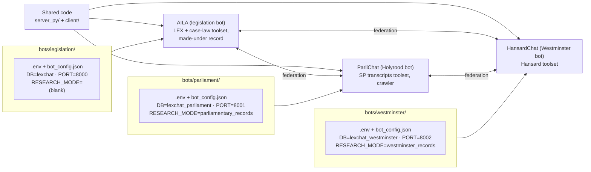

`RESEARCH_MODE` (env) → `research_mode` drives four things:

| Driven by mode | Where |
|---|---|
| Worker toolset | `tools/schemas.py::get_worker_tools(mode, chat_mode)` |
| Manager + Worker system prompts | `prompts.py::get_manager_system_prompt` / `get_worker_system_prompt` (both also read `chat_mode`) |
| Efficiency profile (breach rules + dashboard bands) | `config.py::EFFICIENCY_PROFILES` / `get_efficiency_profile()` |
| Startup background tasks | `main.py::lifespan` — the Holyrood crawler and caption backfills (`parliamentary_records`); the made-under record's load and daily refresh (every mode except the two parliamentary ones) |

Modes: `legislation_only`, `case_law_only`, `legislation_and_case_law`, `parliamentary_records`,
`westminster_records`. On the legislation bot `RESEARCH_MODE` is blank, so the mode is the
**research type** the lawyer picks per request under Filters → Research type (Legislation only /
Case law only / Legislation & case law), defaulting to `legislation_only`. A set `RESEARCH_MODE` is
absolute (`resolve_research_mode`): a request body cannot talk a parliament bot into legislation
mode, because its database, tools and crawler are mode-specific.

| Tool set (`schemas.py`) | Tools | Offered in |
|---|---|---|
| `WORKER_TOOLS` | `search_legislation`, `lookup_legislation`, `find_instruments_made_under`, `search_legislation_sections`, `get_legislation_changes`, `get_legislation_text` | `legislation_only`, and with `CASE_LAW_TOOLS` in `legislation_and_case_law` |
| `CASE_LAW_TOOLS` | `search_case_law`, `get_case_law_text` (descriptions swapped for SCTS-aware ones when `scts_caselaw_enabled` is on) | `case_law_only`, `legislation_and_case_law` |
| `PARLIAMENT_TOOLS` | `get_member_info`, `search_bills`, `search_scottish_parliament`, `search_scottish_plenary`, `get_scottish_plenary_debate`, `search_scottish_committee_transcripts`, `get_scottish_committee_transcript` | `parliamentary_records` |
| `WESTMINSTER_TOOLS` | `search_hansard`, `get_hansard_debate`, `get_member_info`, `search_bills` | `westminster_records` |

In **Conversational** chat mode on the legislation bot the Worker is the quick-lookup Worker, and
its list omits `get_legislation_text` (`QUICK_LOOKUP_WITHHELD_TOOLS`); a call naming it anyway is
answered in code and never reaches LEX.

Each bot is an independent process with its **own database and port**; identity (name, tagline,
logo, brand colour) comes from `bot_config.json` and reaches the client via `GET /api/bot-info` and
`GET /api/bot/logo`, so one frontend bundle renders as any bot. The server reads only
`bot_identity` and `peer_registry_seed` from `bot_config.json`; its `agent.research_mode` key is
descriptive, and the mode comes from `RESEARCH_MODE`.

---

## 4. Request lifecycle — Manager / Worker (sequence)

The Manager handles conversation and delegates research to the Worker. The Manager streams tokens to
the browser over SSE; the Worker's intermediate reasoning is not streamed.

There are three **chat modes** (the sidebar's Mode menu, `chat_mode`), separate from the research
type of §3:

- **Conversational** — the Manager answers in its own words and delegates to the quick-lookup
  Worker (`WORKER_SYSTEM_PROMPT_CONVERSATIONAL`). That Worker has no whole-text read, so before it
  first searches within a statutory instrument, code looks the instrument up
  (`lookup_legislation`), which supplies its recital and `valid_date`.
- **Research** — the Manager delegates to the research Worker and reproduces its structured report
  (BLUF → analysis → jurisdiction & status → references) verbatim.
- **Deep Research** — plan, approve, execute (§6).

On the parliament and Westminster bots the Manager and Worker each use one prompt in both
Conversational and Research mode.

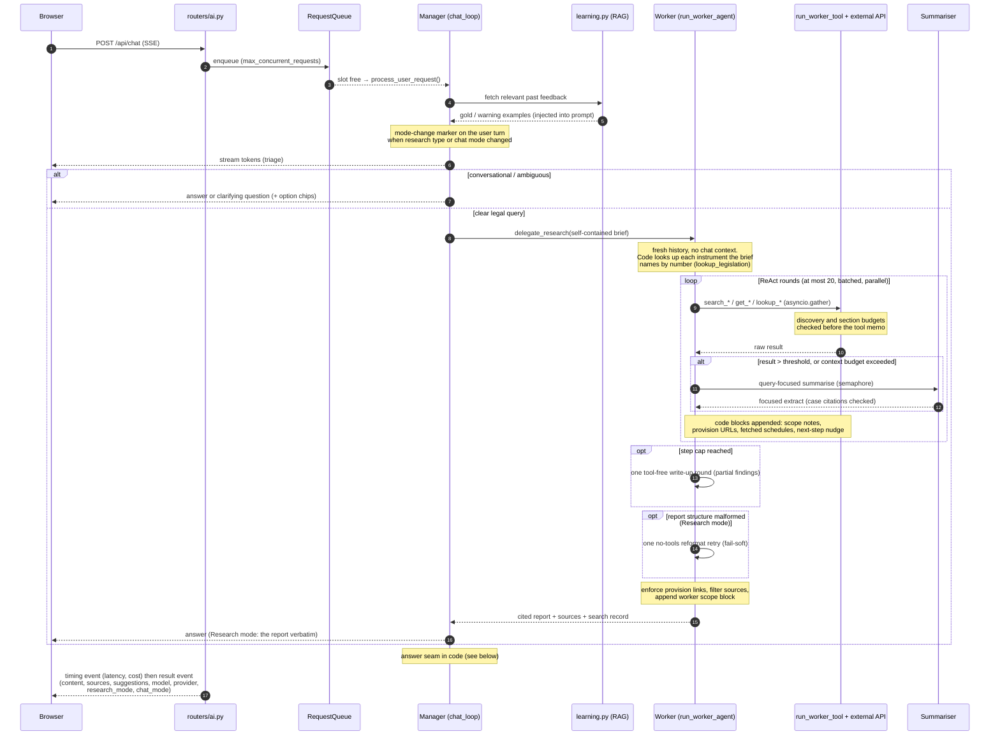

**The answer seam** — after the Manager writes, `process_user_request` (`agent_core.py`) works on
the answer in code, in this order. `/api/consult` runs the same function, so a consulted peer's
answer is cleaned the same way before it reaches the calling bot.
1. Strip the `<suggestions>` block (attached as chips), any scope footer the model copied from the
   history, and an unscoped agreement opener ("You are absolutely right…", `utils/openers.py`).
2. Conversational mode only: put back a sibling subsection the Worker's report gave and the answer
   dropped (`citation_links.restore_dropped_siblings`), a schedule paragraph code handed the Worker
   and the answer dropped (`utils/paragraph_restore.py`), and, on the legislation bot, link an
   instrument the answer names in words to the URL a report gave it
   (`citation_links.link_named_instruments`). The restored text is the Worker's or the statute's
   own words, never generated.
3. Enforce provision links (`citation_links.enforce_provision_links`, also run on each Worker
   report): a legislation.gov.uk provision URL no tool returned is retargeted to the Act and marked
   when the Act was retrieved, or unlinked to bold when it was not.
4. Strip scope blocks and halt markers, then disclose in code every research step that halted at
   the step cap, and every step whose report was lost and that no later delegation made good.
5. Build the **Sources rail**: each Worker report keeps only the sources it vouches for
   (`filter_worker_sources`, by token, title or instrument number); a source the turn retrieved that
   the answer names is re-admitted (`readmit_answer_sources`); a bare-id entry is titled from the
   turn's own results or the made-under record (`utils/rail_titles.py`).
6. Append the lawyer-facing **scope footer** (`utils/search_scope.py`): what was searched and under
   what limits, the case-law corpus disclosure, and lookup outcomes. A reply that ran no search,
   after one that did, says so and restates the earlier searches, labelled as earlier in the
   conversation (gated on structure, never on the answer's wording).

**Caps and resilience**
- **Step cap** — `chat_loop` is capped at 20 ReAct rounds. At the cap it makes one more call with
  no tools (`utils/research_halt.py`), so the retrievals already in context become partial
  findings; the halt keeps its status, the report says the findings are partial, and the lawyer is
  told in code. Tool results are hard-capped to `summarise_threshold + 4,000` chars *after*
  summarisation.
- **Summarisation threshold scales with the model** — 10% of the model's context in chars, clamped
  to [10K, 200K] (`get_summarise_threshold()`), falling back to 8,000 chars when the model's context
  length cannot be resolved. Because that caps each result but never their *sum*,
  `run_worker_agent` also carries a per-run **`WORKER_CONTEXT_BUDGET_CHARS = 250_000`**: once the
  running total would exceed it, a result is summarised regardless of its own size.
- **Discovery budgets** (`utils/discovery_budget.py`, fresh per worker run) — a legislation Worker
  may call `search_legislation` in at most **8** ReAct rounds, and `search_legislation_sections` on
  any one instrument in at most **3**; a parliamentary Worker gets **3** discovery searches. The
  legislation budgets count *rounds*, not calls, because the model batches. A refused call returns a
  stop result instead of running, is recorded as a limit (stated in the Worker's scope block and the
  lawyer's footer) and counts in `search_budget_blocked`.
- **Graceful failure in three layers** — a failed worker run returns an `[Research Agent Error]`
  *tool result* to the Manager rather than killing the SSE request; `describe_agent_error` gives
  every user-facing failure real text (httpx timeouts stringify to `""`); `/api/chat` wraps that in
  a "try again, or narrow the question" error event. Real user aborts still propagate.
- **Bounded retries** — the provider stream is retried up to 3 times, but **only while nothing has
  been emitted** (replaying would duplicate tokens); LEX and Find Case Law calls retry
  `{429, 502, 503, 504}` with exponential backoff honouring `Retry-After`.
- **Empty completions** (`utils/empty_completion.py`) — a completion with no content and no tool
  calls is retried inside that same bounded loop, with exceptions: a Worker call that reasoned
  heavily and emitted nothing, or hit an upstream idle timeout, is not retried (its report is
  labelled lost and the Manager re-delegates); while a usable worker report is in hand, the
  Manager's heavy empty is not retried and its idle timeout is retried once. On OpenRouter, Worker
  and Manager calls carry `max_tokens` 32,000 to bound a reasoning runaway. A Manager that still
  returns nothing falls back to the worker reports already in hand, labelled as such.
- **Mode-change marker** (`utils/mode_change.py`) — every saved assistant message is stamped with
  the research type and chat mode it ran under (echoed on the `result` event and sent back with the
  history). When this request's modes differ from the previous reply's, a `[SYSTEM NOTICE …]`
  marker is prefixed to the user's turn (Manager and Deep Research planner). Prompts take the names
  of the two controls from constants in that module, never by hand.
- **Suggested-question chips** — the model emits a tagged `<suggestions>` block; it is stripped and
  attached at the **Manager return in `agent_core.py`**, not in the router, because
  `process_user_request` also serves `/api/consult` — so a peer's chips can never leak into the
  calling bot's context. Live only: no DB column, gone after reload. Governed by the
  `suggested_questions_enabled` flag, which *substitutes the instruction out of the prompt* rather
  than overriding it (the strip stays unconditional as belt-and-braces). A chip that offers to
  change a mode or filter is dropped, since a chip can only send text.
- **Concurrent runs are in-tab only** — up to 3 per browser tab (`useChatRuns.js`); a refresh or tab
  close still destroys a run, because `/api/chat` never writes the assistant message itself. The
  durable design is deliberately deferred — see [CONCURRENT_RUNS_DURABILITY.md](CONCURRENT_RUNS_DURABILITY.md).

---

## 5. Worker research pipeline (legislation mode)

The Worker follows a prescribed multi-phase process. Discovery is deliberately slimmed and batched
so that Phase 1 rarely needs summarisation; Phase 2 does the real retrieval. Around it, code runs
lookups and fetches the model is not trusted to ask for.

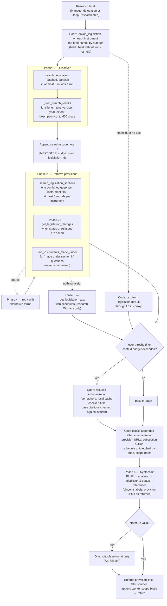

**`run_worker_tool` is the one seam every Worker tool call passes through** (`agent_shared.py`).
In order: open the audit record; check the legislation discovery and section budgets (before the
memo, so a step repeating its own search is refused too); serve an exact repeat from the
per-request tool memo; check the parliamentary search budget; dispatch to the executor for the
bot's mode; extract sources and harvest every legislation.gov.uk URL from the **raw** result; build
the code notes from the raw result; run the published-text route; summarise if needed; append the
post-summary blocks and the schedule route; append the phase nudges last, so the summariser can
never discard them.

**What code adds to a legislation Worker's context**

| Material | When | Where |
|---|---|---|
| Instrument lookup | Before round 1, for each instrument the brief names by number (research types with legislation); in quick-lookup mode, also before the first section search of each SI | `utils/instrument_lookup.py` |
| Search-scope notes | On every legislation search and section search result: what was searched, under which limits (filters, the window shown of the ranked matches), and what the result can and cannot establish | `utils/search_scope.py` |
| Provision URLs + subsection outline | After a section search is summarised (the summary keeps section numbers and drops both) | `summarised_result_blocks`, `utils/section_outline.py` |
| Schedule or annex unit | A section search names a schedule or annex unit its results lack: the instrument's provision list is fetched once (`/legislation/section/lookup`, at most 8 instruments a run) and the unit cut by `uri`; an oversize unit goes as its paragraph headings plus the paragraphs whose headings match the query | `schedule_route_block`, `utils/schedule_units.py` |
| Schedules note | A whole-text read sends `include_schedules`; the note says which schedules and annexes the text carries, or that the index holds none | `utils/schedule_units.py` |
| Enabling-power block | A text read, section search or lookup: an instrument's enabling power may be stated only from a retrieved recital; where LEX's record has none, the made-under record's stored recital is offered instead | `utils/search_scope.py`, `stored_enabling_note` |
| Change-record blocks | `get_legislation_changes`: relations grouped and deduplicated, removals classed (provision, in part, words only, qualified), commencements by another instrument dated where legislation.gov.uk records a date | `tools/lex.py`, `utils/removal_effects.py`, `tools/commencement_dates.py` |
| Made-under list | `find_instruments_made_under`: at most 40 instruments listed with the total, the record's coverage and each one's revocation status, never summarised | `services/made_under_store.py` |
| Published text | A lookup says not held or held without text, or a text read comes back empty or not found: the made/enacted version, then the current one, read from legislation.gov.uk through LEX's proxy (at most 8 instruments a request, never cached) | `utils/published_text.py`, `tools/published_text.py` |
| Not-held note | A retrieval by id that LEX answered "not found": a gap in the index, not evidence the citation is wrong | `utils/search_scope.py` |

**The search record and the scope footer.** Each worker run keeps a search record (`search_log`):
every search issued (memo hits included), budget stops, lookups and their outcomes, not-held
results, enabling-power evidence, change-record relations, currency evidence and case-law searches.
`utils/search_scope.py` renders it at four seams: a note on each tool result for the Worker; the
`worker_scope_block` appended to the Worker's report *after* it writes, read only by the Manager or
the Deep Research synthesis; the lawyer-facing footer appended in code to the answer (§4); and an
unconditional strip so the agent-addressed blocks never reach the screen. A negative is therefore
stated with the searches and limits it was reached under, whatever the model chose to say.

**Mode variants of the same discover → retrieve → synthesise shape:**

| Mode | Discovery | Retrieval | Notable enforcement |
|---|---|---|---|
| Legislation | `search_legislation`; code's `lookup_legislation` on instruments named by number | `search_legislation_sections`, `get_legislation_changes`, `find_instruments_made_under`, `get_legislation_text` (fallback, research Workers only) | 8-round discovery budget; 3 section-search rounds per instrument; the code-added material above |
| Case law | `search_case_law` (Find Case Law, most relevant first, 50 a page; SCTS's Scottish judgments alongside as `scottish_results` when `scts_caselaw_enabled` is on) | `get_case_law_text` (routed by host: a Find Case Law judgment, or an SCTS PDF read with pdfplumber) | appellate-decision detection nudges the Worker to the higher-court judgment; a case the query names that the results lack is noted in code (`caselaw.named_case_note`); SCTS calls capped per request (60 searches, 20 texts) |
| Holyrood (`parliamentary_records`) | `search_scottish_plenary` / `_committee_transcripts` (local FTS), `search_scottish_parliament` (excerpt fallback) | `get_scottish_plenary_debate` / `get_scottish_committee_transcript` (live fetch + parse) | hard **search budget of 3** discovery calls, enforced in `run_worker_tool`; retrieval capped at 150 speeches per item |
| Westminster (`westminster_records`) | `search_hansard` (live API; chamber / Westminster Hall / PBC / written) | `get_hansard_debate` (verbatim contributions) | same search-budget shape; contributions capped at 150 per debate |

Both parliamentary modes exist to answer *Pepper v Hart*-style questions — retrieving a Minister's
exact words on statutory purpose — which is why verbatim retrieval, not excerpts, is the goal and
why the transcript caps report `total_speeches` and tell the model to narrow rather than truncating
silently.

---

## 6. Deep Research (plan → approve → execute)

An opt-in `chat_mode = "deep_research"` that drafts an **editable** plan, lets the lawyer change it,
then executes it autonomously. Plan-first is what makes the run steerable and leaves an auditable
approved-plan artefact. **L2 only** — there is no pause-and-review between steps.

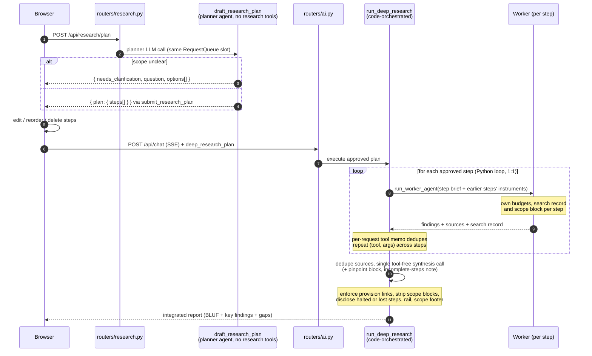

- **Code-orchestrated, not prompt-driven** — one `run_worker_agent` call per approved step gives a
  deterministic mapping between what was approved and what was done.
- **Step handover** — every step after the first gets one code-written line naming the instruments
  the earlier steps' reports cite (up to 40, `utils/step_handover.py`), so a step that works on an
  earlier step's list works on that list rather than searching for it again.
- **Each step is a full worker run** — its own discovery, section and context budgets and its own
  search record. A step that halted or whose report was lost reaches the synthesis as partial or
  missing (`incomplete_steps_note`), never as a step that found nothing, and is disclosed to the
  lawyer in code.
- **Synthesis inputs** — the step findings, plus `citation_links.pinpoint_block` (the pinpoint
  labels the steps linked per section URL), so the integrated report keeps subsection-level
  citations. The report then passes through the same link enforcement, scope-block strip, sources
  rail and scope footer as the Manager path (§4); there are no suggestion chips.
- **Audit column** — `messages.research_plan` (additive JSON) persists the approved plan on the
  assistant message and the UI renders it back.
- **Efficiency carve-out** — a DR run legitimately fans out to N delegations, so it is exempt from
  the fan-out breach rules and excluded from the Efficiency dashboard's baselines.
- Planner clarifications reuse the suggested-question chip render path, under the same
  no-speculation guardrail: only scope choices grounded in the conversation or in tool results.
- A provider HTTP error on the planner call is reported with its cause
  (`planner_provider_error`): an account or credit refusal says retrying will not help; a rate
  limit says to try again in a few minutes. The provider's own response body is never shown.
- Build spec: [deep-research/IMPLEMENTATION_PLAN.md](deep-research/IMPLEMENTATION_PLAN.md).

---

## 7. Provider resolution & concurrency

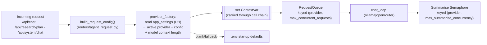

- `AppSetting(key="provider.ollama")` and `AppSetting(key="provider.openrouter")` store per-provider
  JSON blobs (`base_url`, `api_key`, `model`, `summarisation_model`, `temperature`, concurrency).
- A separate `summarisation_model` can be configured per provider so a fast/cheap model handles
  document summarisation while a capable model does reasoning.
- The resolved model's **context length** rides on the request config and sets the summarisation
  threshold (§4). It is resolved from the curated lists (`MODEL_LIST`, `OPENROUTER_MODEL_LIST`), then
  OpenRouter's own model list; a model found in neither is summarised at the 8,000-char fallback.
- On OpenRouter, Worker and Manager calls carry an output cap (`max_tokens` 32,000,
  `WORKER_MAX_OUTPUT_TOKENS`); Ollama calls carry none.
- Ollama summarisation concurrency should be **1** (concurrent calls to the cloud endpoint 500);
  OpenRouter tolerates 5+.
- **Model quality dominates**: a capable instruction-follower batches Phase 2 correctly and finishes
  an 8-Act query in ~90s; a weak model ignores batching and is ~10× worse on identical
  infrastructure.

---

## 8. Caching stack

Three cooperating cost-reduction layers, all additive and fail-soft, each behind a feature flag, all
reporting into Admin Portal → **Cache** (`GET /api/stats/cache`, backed by additive
`request_timings` columns).

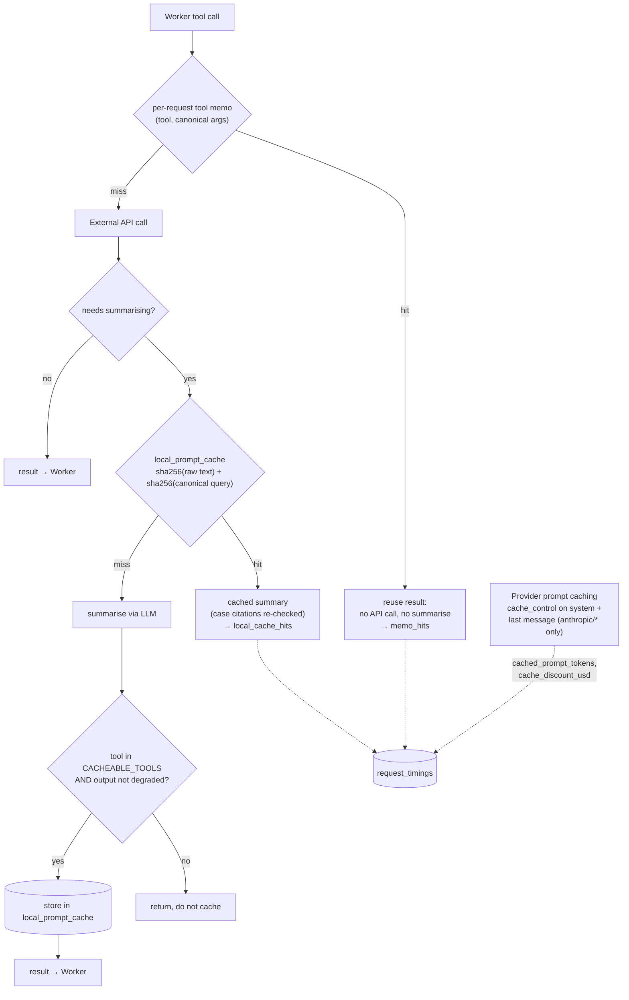

| Layer | Scope | Key | Flag |
|---|---|---|---|
| Provider prompt caching (D5) | one provider call | provider-side prefix | `prompt_caching_enabled` |
| Per-request tool memo (D5/D8) | one request (dies with it) | `(tool_name, canonical args JSON)` | `tool_memo_enabled` |
| Local prompt cache (D7/D8) | **cross-user, cross-provider**, persistent | `sha256(raw pre-summarisation text)` + `sha256(canonicalised query)` | `local_prompt_cache_enabled` |

**Why the local cache is safe to share:** identical hash ⇒ identical source text, so staleness is
impossible (amended text produces a new hash → a miss). It is **exact-match only, no embeddings** —
semantic near-miss reuse risks silent incompleteness. `summarise_model` is stored for provenance but
kept *out* of the key, which is what makes it cross-provider.

**Guardrails worth knowing before touching it**
- Only tools on the explicit `CACHEABLE_TOOLS` allowlist may be stored — the cache is shared across
  users, so a new tool must be confirmed public-source-only first.
- Degraded/partial summariser output (the raw-text fallback) is **never** stored; one transient
  error would otherwise poison a shared key permanently.
- Every summary, fresh or served from the cache, passes `summarisation.check_summary_citations`
  (`utils/summary_citations.py`): a case citation the source text does not hold is removed.
- The key query is the **raw user question** in standard mode (not the Manager's per-model
  paraphrase, which would make cross-user hits luck) and the approved step text in Deep Research.
- The cache is **forced off in code** for `research_mode == "drafting"`, in `build_request_config()`
  — a drafting bot's input is unpublished legislative text and must never reach a shared plaintext
  column. Consequence: a drafting bot's Cache tab shows "Local cache: ON". That is expected.
- The query hash carries a canonicalisation version prefix (`_CANON_VERSION`, now `v3`). Bump it on
  any change to the canonicalisation *or* to the summariser's prompt (neither half of the key sees
  the prompt); bumping invalidates the whole cache.
- Hygiene: a sampled prune (~2% of stores) above 20K rows removes never-hit rows older than 90 days
  and any row idle for over a year.
- **Not built:** a LEX/case-law response cache — measurement showed LLM time dominates external-API
  time ~16:1. Deferred until traffic says otherwise.
- Plans: [LOCAL_PROMPT_CACHE_PLAN.md](LOCAL_PROMPT_CACHE_PLAN.md),
  [CACHE_REVIEW_FIXES_PLAN.md](CACHE_REVIEW_FIXES_PLAN.md), [CACHE_ADMIN_UI_PLAN.md](CACHE_ADMIN_UI_PLAN.md).

---

## 9. Federation

When at least one enabled peer is registered, the Manager gains a `consult_peer` tool alongside
`delegate_research`. With zero peers the behaviour is identical to a single-bot deployment (the tool
is simply absent).

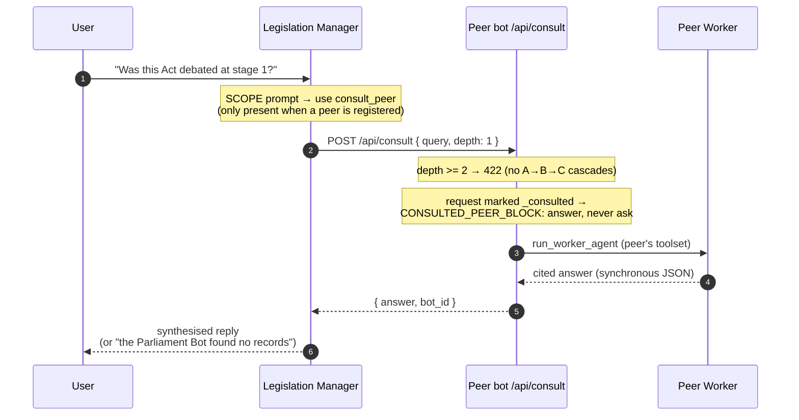

- Peer registry lives in the `peer_bots` table (Admin Portal → Federation tab, or `/api/peers`).
  `api_key` is **write-only** — never returned by any response. `PUT /api/peers/{peer_id}` takes the
  string peer id, not the numeric row id; the `bot_config.json` seed is insert-or-ignore and never
  updates an existing row.
- `/api/consult` is **synchronous JSON**, not SSE — the calling Manager blocks for the full answer.
- Manager prompts carry cross-bot SCOPE rules in both directions, and distinguish "the peer found no
  records" from "no parliamentary peer is registered" — the latter is the only case that may be
  reported as unavailable.
- A consulted peer **never asks the user anything**: the consult channel is one-shot and stateless,
  so a clarifying question would come back *as the answer*. The block is appended on all three
  return paths of `get_manager_system_prompt` (the parliament/Westminster branch returns early).

---

## 10. Legislation data — the LEX index and what is read around it

The legislation bot answers from the **LEX API**, an index over legislation.gov.uk data. Where LEX
does not carry what a question needs, code reads legislation.gov.uk itself, always through LEX's own
proxy, or a record harvested from it in advance.

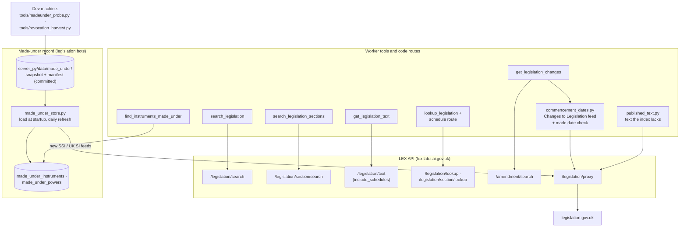

- **The index.** Search (`/legislation/search`, ranked, slimmed to id, title, URL, text version,
  year, extent and a 600-char description), section search, whole-text read (with
  `include_schedules`), the exact held/absent test (`/legislation/lookup`; `/legislation/section/lookup`
  returns every provision of an instrument and is the route to one schedule or annex by `uri`) and
  the change record. LEX's read endpoints are POST. A ranked search cannot show that an instrument
  is absent; the lookup can, which is why code runs it on instruments named by number.
- **The change record** — `/amendment/search` returns amendment, commencement, repeal and revocation
  relations, provision to provision. `get_legislation_changes` groups and deduplicates them and
  classes each removal by its effect type (`utils/removal_effects.py`). For a commencement made by
  another instrument, `commencement_dates.py` reads legislation.gov.uk's dated "Changes to
  Legislation" feed for the instrument (one read per change-record call, memoised per request, at
  most 2 pages, 8 s, fail-soft) and adds the date and its qualification; a date earlier than the
  commencing instrument's made date is refused. The date says when a provision was brought into
  force, never that it is in force now.
- **The made-under record** (P3.31, P3.33) answers "which instruments were made under section N of
  this Act?", which no endpoint returns. A harvest of each instrument's as-made preamble recital
  (Scottish SIs from 1999 and UK SIs from 1987; Welsh SIs and Northern Ireland Orders in Council are
  held under their UK SI numbers) is parsed by `utils/made_under.py` and committed as a snapshot with
  a `manifest.json` stating its coverage. On a legislation bot `background_made_under_loop` loads it
  into two tables at startup when its version differs from the one recorded in `app_settings`
  (`made_under.snapshot`), then, ten minutes later and daily, adds newly published SSIs and UK SIs
  from legislation.gov.uk's new-legislation feeds through the proxy. Each instrument carries a
  revocation flag (`revocation`, `revocation_checked`) from the Changes to Legislation record;
  revocations are **snapshot-only** — refreshed by re-harvesting and committing, so an instrument the
  daily refresh added has none checked. The tool lists at most 40 instruments with the total, the
  coverage and each one's revocation status; `agent_shared.stored_enabling_note` answers the forward
  question (what one instrument was made under) where LEX's record carries no recital. The tool
  answers `unavailable` while the tables are empty, and the per-read lookups (stored recitals, rail
  titles) do not touch the database until the record has loaded.
- **Text the index lacks** (P3.38) — where a lookup says not held or held without text, or a text
  read comes back empty or "not found", `published_text.py` reads the made or enacted version, then
  the current one, from legislation.gov.uk through the proxy (15 s a read, at most 8 instruments a
  request, memoised per request, never cached) and hands it to the Worker as a block marked as
  fetched by code; the answer says where the text came from.
- **Scottish judgments (SCTS)** sit beside Find Case Law rather than LEX: with
  `scts_caselaw_enabled` on, `search_case_law` also POSTs SCTS's judgments search and returns its
  rows as `scottish_results`, and `get_case_law_text` reads an SCTS judgment PDF (pdfplumber, in a
  thread). With the flag off, every case-law prompt, tool description and footer is exactly as
  without SCTS.
- Coverage, gaps and the evidence behind them: [LEGAL_DATA_SOURCES.md](LEGAL_DATA_SOURCES.md).

---

## 11. Parliamentary data pipelines

### Holyrood — crawl into local FTS, retrieve verbatim on demand

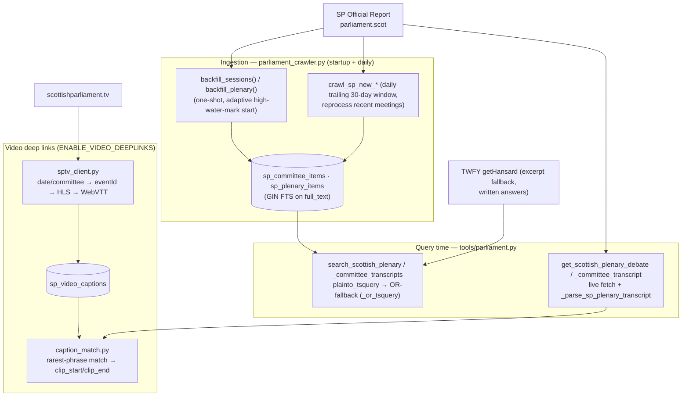

- **FTS, not embeddings** — a measured go/no-go gate found FTS-only sufficient (semantic retrieval is
  deferred/NO-GO). Two cheap wins shipped instead: an **OR-fallback** when `plainto_tsquery` (all
  terms AND-ed) returns zero rows, and **prompt-level query wording** (use the official Holyrood
  term, e.g. *unhoused → homeless*). Raw hit-rate ~85% → ~88%; residual misses recover on the
  single permitted reformulation retry.
- **Incremental crawl** — the source sends no `Last-Modified`/`ETag`, so change detection is driven
  by our own stored state: adaptive backfill start (full Session-6 walk only on an empty table) plus
  a trailing-window daily re-scan that reprocesses recent meetings, catching late-published
  transcripts. Not covered: revisions to finalised transcripts outside the 30-day window.
- **One parser for both** — committee pages now use the same `
` markup as
  plenary, so `_parse_sp_plenary_transcript` serves both the retrieval tools and the crawler.
- **Video timing** — segment ordinal × 6s using the *true* HLS playlist index (not caption-stream
  MPEGTS transitions, which undercount because ~7% of segments carry no captions),
  Europe/London DST-correct, anchored to the agenda item by rarest-phrase match. Fully fail-soft.
  Coverage: ~1,140 events cached, ~47% with a usable caption track (skewed to recent sittings).
- Data model detail: [parliament/PARLIAMENTARY_DATA.md](parliament/PARLIAMENTARY_DATA.md).

### Westminster — live API, no crawl

`tools/westminster.py` calls the Hansard API directly: `search_hansard`
(`/search/contributions/{type}.json`, filterable by House, record type and date) then
`get_hansard_debate` (`/debates/debate/{ext_id}.json`) for the full attributed contributions, plus
the Members API and Bills API for member and bill lookups. There is **no local corpus and no
crawler** for Westminster — Hansard search is already full-text and relevance-ranked, so the
retrieval quality problem that motivated the Holyrood crawl does not exist here. Citations link to
`hansard.parliament.uk`.

---

## 12. Data model (core entities)

Selected tables from `server_py/src/models.py` and the raw-SQL tables of `database.py`. FTS/crawler,
cache and timing tables are described below the diagram.

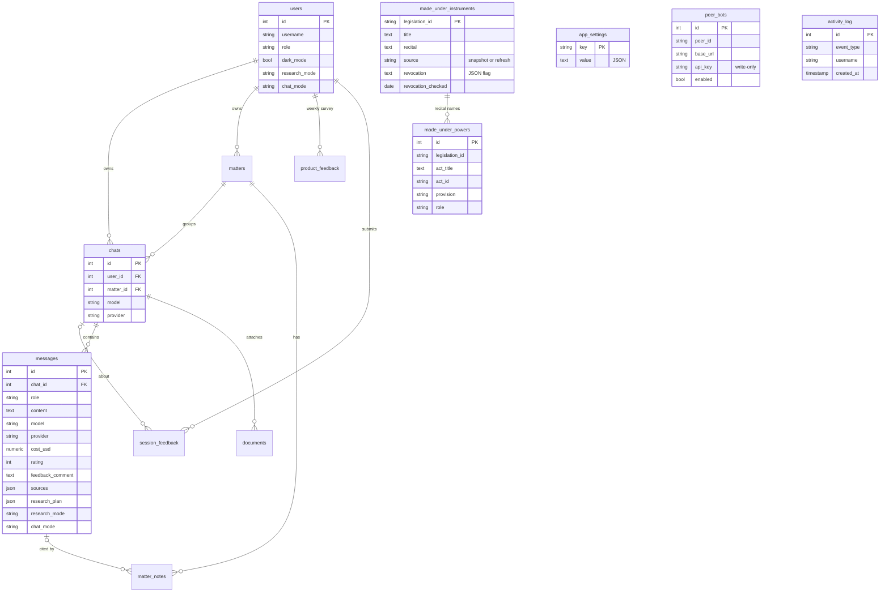

- **Parliament FTS / video tables** (Holyrood bot DB): `sp_committee_items` and `sp_plenary_items`
  (one row per agenda item, GIN FTS on `full_text`, keyed `(meeting_id, iob_id)`);
  `sp_video_captions` (one row per SP TV event, cached `transcript` + `offset_index`).
- **Made-under tables** (created on every bot, filled only on legislation bots, §10):
  `made_under_instruments` (one row per instrument: title, recital, revocation flag and the day it
  was checked; `source` says whether the snapshot or the daily refresh added it) and
  `made_under_powers` (one row per enabling provision a recital names, indexed by Act and
  provision). They join on `legislation_id`; there is no foreign key.
- **`request_timings`** — one row per request: latency phases, token/cost counts, tool and phase
  counters, `chat_mode`, `research_mode`, `provider`, `model`, cache metrics (`cached_prompt_tokens`,
  `cache_discount_usd`, `memo_hits`, `local_cache_hits`, `local_cache_chars_saved`), efficiency
  counters (`search_budget_blocked`, `report_reformat_retries`, `max_turns_halted`) and `source`
  (`app` / `eval`).
- **`local_prompt_cache`** — the cross-user summary cache (§8): content+query hash, summary,
  `hit_count`, `last_hit_at`.
- **Other tables**: `documents` (uploaded file text), `product_feedback` (the weekly productivity
  survey), `session_feedback` (the end-of-session form, linked to its chat), `service_health_logs`,
  `matters` / `matter_notes`. A per-answer rating lives on the message itself (`messages.rating`,
  `feedback_comment`).
- **Runtime config vs provenance** — `app_settings` holds runtime provider config
  (`provider.ollama`, `provider.openrouter`), the feature flags (`features`) and the loaded
  made-under snapshot version (`made_under.snapshot`); DB values override `.env` at request time.
  `chats.model/provider` record the selection at chat creation; `messages.model/provider` record
  what was *actually* used at inference time (authoritative provenance), and
  `messages.research_mode/chat_mode` the modes the reply ran under (§4).
- **Activity Log is mostly synthesised** — only `LOGIN`, `EFFICIENCY` (breach alerts) and `RESTORE`
  rows are written to `activity_log`; `QUERY`, `RESPONSE`, `SURVEY`, `FEEDBACK` and `ERROR` events
  are derived at query time by UNION ALL over `messages`, `product_feedback`, `session_feedback` and
  `service_health_logs`, with filters applied inside each branch so `limit` reflects the filtered
  set.

---

## 13. Measurement & observability

Two audiences: operators watching a live bot (Admin Portal) and the external eval harness.

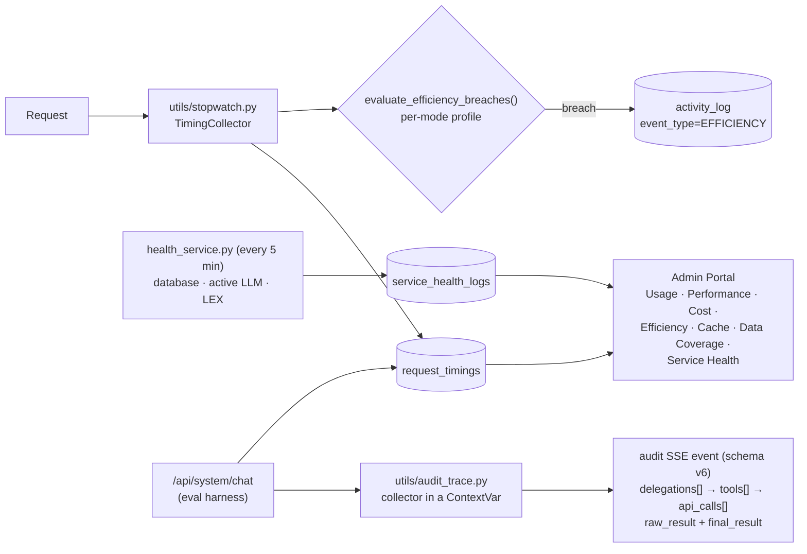

- **Per-bot efficiency profiles** — the same code grades each bot against different baselines,
  selected by `research_mode`. Fan-out denominator differs by mode (legislation: retrievals per kept
  source; parliamentary/Westminster: retrievals per distinct transcript/debate) and is
  allowlist-validated before it is interpolated into SQL. Parliamentary and Westminster band values
  are **unmeasured starting points**; the `reformat` band is unmeasured on every profile.
- **Prompt-adherence measurement** — `report_reformat_retries` + `model` answer "how often does this
  model ignore the OUTPUT STRUCTURE rules", surfaced as a rate and a per-model table. Per-model is
  the point: a rate high across all models indicts the prompt, one concentrated in a single model is
  a model-selection question. Indicator only, no breach rule (the retry is fail-soft). A halted or
  lost worker report skips the reformat retry, so it is not scored as a structure failure.
- **Audit trace** — a structured trace emitted once before `result`, replacing the harness's
  reconstruction of a UI-shaped stream (which matched on *display labels* and was already silently
  broken for Deep Research). Nesting comes from the call graph, not event order: delegations open in
  `run_worker_agent`, tool records in `run_worker_tool` (handed their delegation explicitly, so
  nesting survives future parallelism), API calls by sniffing `on_chunk` inside the tool's scope.
  `raw_result` alongside `final_result` is the analytical addition — it separates a bad retrieval
  from a bad summary. Off unless requested, and every collector method swallows its own errors.
- **Audit schema version** — `AUDIT_SCHEMA_VERSION = 6`. Every addition has been an additive key:
  `delegations[].halted` (the step cap, with `written_up` saying whether the write-up round produced
  findings), `delegations[].lost` (a worker whose final reply was empty on every attempt), and
  top-level `empty_completions[]` and `mode_change`.
- **Eval traffic is tagged, not filtered** — `request_timings.source` separates `app` from `eval`,
  but the dashboards do not filter on it yet, so a large sweep moves the headline numbers. Eval runs
  write no EFFICIENCY breach rows.
- Spec: [api/AUDIT_TRACE.md](api/AUDIT_TRACE.md); plans:
  [planning/EFFICIENCY_PER_BOT_PLAN.md](planning/EFFICIENCY_PER_BOT_PLAN.md),
  [planning/PER_REQUEST_EFFICIENCY_PROFILE_PLAN.md](planning/PER_REQUEST_EFFICIENCY_PROFILE_PLAN.md).

---

## 14. Backup & scoped restore

Nightly `pg_dump -Fc` per database, plus a Developer-tab restore that is the inverse of the Danger
Zone: it puts back one scope at a time rather than restoring a whole server.

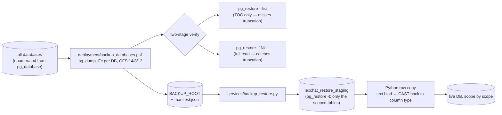

- **`--list` is not the check that works.** In a custom-format archive the TOC precedes the data, so
  a dump truncated to half its length still lists every entry and exits 0. `pg_restore -f NUL` (a
  full read) is what catches truncation. Both stages run in the backup script and on restore.
- **Never restore over live tables.** Staging is a database the app never connects to, and only the
  tables the selected scopes need are staged (0.13s vs 33s for the whole parliament dump; the SP
  corpus is never copied).
- **The copy is Python, not SQL** — `postgres_fdw`/`dblink` need `CREATE EXTENSION` and `lexuser` is
  `NOSUPERUSER`. Values cross as text and are cast back, which requires
  `CAST(CAST(:p AS text) AS <type>)` — asyncpg types a bind parameter from its surrounding cast, so
  a single cast makes it reject the text being sent deliberately.
- **`feedback` is the scope that silently does nothing if you get it wrong** — clearing feedback
  nulls `messages.rating` in place, so the rows survive and an `INSERT … ON CONFLICT DO NOTHING`
  restores nothing while reporting success. That component is an `UPDATE`. Restoring `chats` *and*
  `feedback` together masks the bug.
- Restore order is `list(reversed(_CLEAR_ORDER))`, asserted at import; sequences are `setval`'d
  afterwards; `matter_notes.message_id` links are repaired as part of the `chats` scope.
- **The `cache` scope can never be restored** — `local_prompt_cache` rows are excluded from every
  dump by design, and that is reported as unavailable with the reason. Not a bug.
- **`BACKUP_ROOT` must match the scheduled task's `-BackupRoot`**, or the Developer tab reads an
  empty directory while backups run fine elsewhere. Both default to `C:\LexChatBackups`.
- Design: [BACKUP_RESTORE_PLAN.md](BACKUP_RESTORE_PLAN.md); procedure:
  [deployment/BACKUP_RUNBOOK.md](deployment/BACKUP_RUNBOOK.md).

---

## 15. Deployment view

Native Windows Server 2022 — **no Docker, no WSL.** By default one uvicorn process per bot is the
entire web tier, terminating TLS itself; PostgreSQL runs as a Windows service; the launch script
starts Ollama when it is installed, and it is called only when it is the active provider.

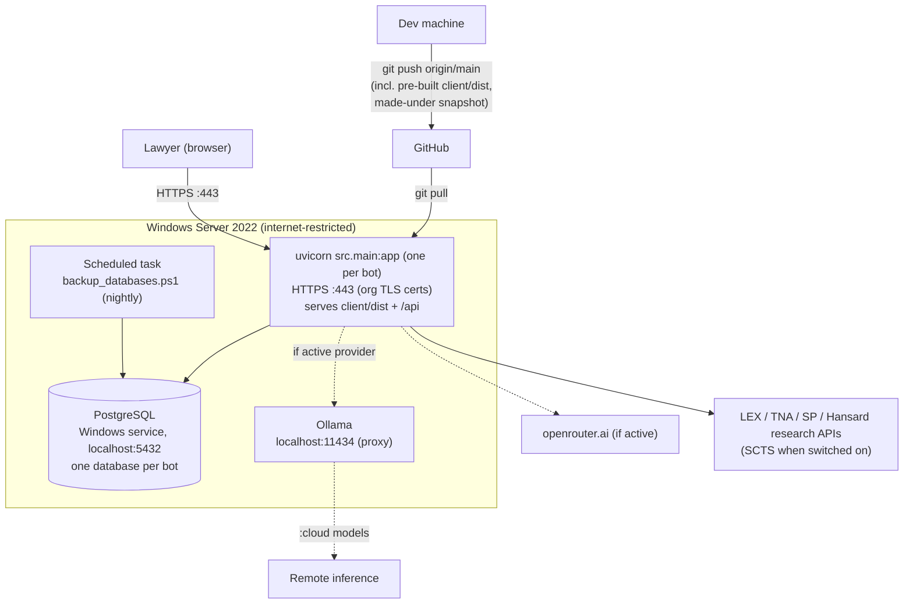

**Lifecycle**
- **Start/stop** — `deployment/start_native.cmd` (PostgreSQL → Ollama → uvicorn) and
  `deployment/stop_native.cmd`. Note `start_native.cmd` copies `.env.native` over `.env` on every
  start, so `.env.native` is the *live* target config and must not carry tracked per-machine edits.
  Its options: `--port N`, `--no-ssl`, and `--nginx` (an optional mode with nginx on port 80 in
  front of uvicorn on 8000). The Holyrood bot runs on its own server under
  `deployment/start_parliament.cmd`, which loads `bots\parliament\.env` and its `bot_config.json`.
- **Updates** — the *only* deployment path is `git pull` from `origin/main`. The frontend is
  pre-built on the dev machine and committed (`client/dist/`, force-added); the target needs no
  Node.js. The made-under snapshot is committed the same way and loaded on the next start (§10).
  pdfplumber and python-docx, which the offline bundle predates, are installed from committed wheels
  in `deployment/pdf_wheels/` (`install_pdf_support.ps1`). See
  [deployment/NATIVE_DEPLOYMENT.md](deployment/NATIVE_DEPLOYMENT.md).
- **Releases** — calendar versions, `vYYYY.MM.N` (the Nth release cut that month). Each release is an
  annotated tag on `main` and a dated section in `CHANGELOG.md`; the `VERSION` file names the last
  release the code contains. `server_py/src/version.py` reads `VERSION` (`APP_VERSION`) and
  `git describe` of the running checkout (`APP_BUILD`, e.g. `v2026.10.4-3-gabc1234` three commits
  past a release); both appear in `GET /api/bot-info`, the first startup log line
  (`[Startup] AILA <version> (build <build>)`), FastAPI's OpenAPI version and the Release notes
  popup (Settings → Release notes). `tests/test_version.py` fails when the nearest release tag and
  `VERSION` disagree. The target deploys the head of `origin/main`, which can sit past the last
  release.
- **Backups** — `deployment/install_backup_task.ps1` registers the nightly task (needs elevation).
  Off-box copy of the dumps is still outstanding.
- **Local dev** — HTTP on port 8000 (no TLS certs locally); multiple bots via
  `deployment/start_federation_dev.ps1` per [deployment/LOCAL_SETUP.md](deployment/LOCAL_SETUP.md).

---

## Cross-references

| Concern | Document |
|---|---|
| Product spec, features, agent narrative | [SPECIFICATION.md](SPECIFICATION.md) |
| Schema & low-level flow | [DESIGN.md](DESIGN.md) |
| REST/SSE endpoint reference | [api/ServerAPISpec.md](api/ServerAPISpec.md) |
| Eval endpoint + audit trace | [api/AUDIT_TRACE.md](api/AUDIT_TRACE.md) |
| External LEX API | [api/LexAPISpec.md](api/LexAPISpec.md) |
| Legislation and case-law data held, gaps | [LEGAL_DATA_SOURCES.md](LEGAL_DATA_SOURCES.md) |
| Pre-pilot fix plan (row IDs such as P3.31) | [prepilot-fixes/FIX_PLAN.md](prepilot-fixes/FIX_PLAN.md) |
| Firewall / allowlist / ports | [NETWORK_AND_DEPENDENCIES.md](NETWORK_AND_DEPENDENCIES.md) |
| Deployment (target + local) + backup runbook | [deployment/](deployment/) |
| Release history | [../CHANGELOG.md](../CHANGELOG.md) |
| Deep Research build spec | [deep-research/IMPLEMENTATION_PLAN.md](deep-research/IMPLEMENTATION_PLAN.md) |
| Caching stack design | [LOCAL_PROMPT_CACHE_PLAN.md](LOCAL_PROMPT_CACHE_PLAN.md), [CACHE_REVIEW_FIXES_PLAN.md](CACHE_REVIEW_FIXES_PLAN.md) |
| Backup & scoped restore design | [BACKUP_RESTORE_PLAN.md](BACKUP_RESTORE_PLAN.md) |
| Holyrood data model | [parliament/PARLIAMENTARY_DATA.md](parliament/PARLIAMENTARY_DATA.md) |
| Drafting bot (in build, off `main`) | [drafting/BUILD_PLAN.md](drafting/BUILD_PLAN.md) |
| Deferred run durability | [CONCURRENT_RUNS_DURABILITY.md](CONCURRENT_RUNS_DURABILITY.md) |
| Frontend design tokens | [frontend/design-system.md](frontend/design-system.md) |
| Canonical todo list | [TODO.md](TODO.md) |
| Agent/contributor context (canonical) | `../CLAUDE.md` |
